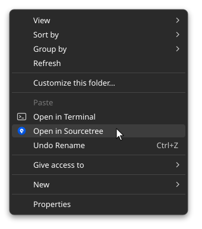

# sourcetree-explorer-menu-windows

Adds an **"Open in Sourcetree"** item to the Windows Explorer right-click menu.
Right-click any folder to open the Git repository it belongs to in [Sourcetree](https://www.sourcetreeapp.com/).

  

## Features

- Shows "Open in Sourcetree" when you **right-click a folder** or **right-click inside a folder's empty space**
- Works from any subfolder: it walks up the tree to find `.git` and opens the **repository root**
- Recognizes `.git` as a file too (submodules, worktrees)
- Shows a `Not a Git repository.` message when the folder isn't inside a repository
- Registers under the current user (`HKCU`) only, so **no administrator rights are needed**

## Requirements

- Windows 10 / 11
- Sourcetree installed in its default location:
  - `%LOCALAPPDATA%\SourceTree\SourceTree.exe`

## Install

1. Download or clone this repository.
2. Double-click `install-sourcetree-menu.bat`.
3. When you see `Installed. Right-click a folder and choose "Open in Sourcetree".`, you're done.

> On Windows 11, the item appears under **"Show more options"** (or `Shift + right-click`).

## Uninstall

Double-click `uninstall-sourcetree-menu.bat`. It removes the registry keys and the launcher folder.

## How it works

The installer creates the following:

| Item | Location | Purpose |
| --- | --- | --- |
| Launcher script | `%LOCALAPPDATA%\OpenInSourcetree\open-sourcetree.vbs` | Finds `.git` from the clicked path and runs `SourceTree.exe -f <repo>` |
| Registry key | `HKCU\Software\Classes\Directory\shell\OpenInSourcetree` | Menu when right-clicking a folder |
| Registry key | `HKCU\Software\Classes\Directory\Background\shell\OpenInSourcetree` | Menu when right-clicking inside a folder |

Each `.bat` file is a batch/PowerShell hybrid: the batch header reads the file itself and runs it with PowerShell using `-ExecutionPolicy Bypass`, so you don't need to change your execution policy.
The menu runs through a VBScript launcher (`wscript.exe`), so no console window flashes when you click it.

## Troubleshooting

- **`SourceTree.exe not found`**: Sourcetree is installed somewhere other than the default path. Edit `$st` in `install-sourcetree-menu.bat` to point to your install path and run it again.
- **The menu doesn't appear**: On Windows 11, check "Show more options", or restart Explorer.
- **Sourcetree moved**: Run the installer again; it overwrites the previous setup.

## License

[MIT](LICENSE)
